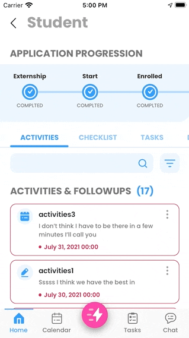

# @r0b0t3d/react-native-collapsible

Fully customizable collapsible views


## Installation

```sh
yarn add @r0b0t3d/react-native-collapsible
```

I am using `reanimated 2` for animation. So you should install and follow instruction here to setup your project [react-native-reanimated](https://docs.swmansion.com/react-native-reanimated/docs/installation)

Install [react-native-gesture-handler](https://docs.swmansion.com/react-native-gesture-handler/docs/fundamentals/installation) too. Wrap your app root in `GestureHandlerRootView`:

```jsx
import { GestureHandlerRootView } from 'react-native-gesture-handler';

export default function App() {
  return (
    <GestureHandlerRootView style={{ flex: 1 }}>
      {/* your app */}
    </GestureHandlerRootView>
  );
}
```

## Key features
1️⃣ Support FlatList/ScrollView
2️⃣ Support sticky header
3️⃣ Can have multiple sticky headers
4️⃣ Easy to customize

## Usage
### 1. Basic
```jsx
import {
  CollapsibleContainer,
  CollapsibleFlatList,
  CollapsibleScrollView,
} from '@r0b0t3d/react-native-collapsible';

// ...
const MyComponent = () => {
  const {
    collapse,   // <-- Collapse header
    expand,     // <-- Expand header
    scrollY,    // <-- Animated scroll position. In case you need to do some animation in your header or somewhere else
  } = useCollapsibleContext();

  return (
    <CollapsibleContainer>          // 1️⃣ (Required) Outermost container 
      <CollapsibleHeaderContainer>  // 2️⃣ (Required) Header view
        <!-- Your header view -->
        <StickyView>                // 3️⃣ Sticky view
          <!-- Your sticky view goes here -->
        </StickyView>
      </CollapsibleHeaderContainer>
      <CollapsibleFlatList          // 4️⃣ (Required) Your FlatList/ScrollView
        data={data}
        renderItem={renderItem}
        headerSnappable={false} // <-- should header auto snap when you release the finger
      />
    </CollapsibleContainer>
  )
}

export default withCollapsibleContext(MyComponent); // 5️⃣ (Required)wrap your component with `withCollapsibleContext`
```

### 2. Advance
We support multiple `CollapsibleHeaderContainer` and `StickyView`. It come useful in case you need to break your code into smaller component.

`Parent.tsx`
```jsx
const Parent = () => {
  const [tabIndex, setTabIndex] = useState(0)

  return (
    <CollapsibleContainer>
      <CollapsibleHeaderContainer>
        <!-- Your header view -->
        <StickyView>
          <TabView currentTab={tabIndex} onTabChange={setTabIndex} />
        </StickyView>
      </CollapsibleHeaderContainer>

      {tabIndex === 0 && <FirstTab />}
      {tabIndex === 1 && <SecondTab />}
    </CollapsibleContainer>
  )
}
```

`FirstTab.tsx`
```jsx
const FirstTab = () => {
  return (
    <>
      <CollapsibleHeaderContainer>
        <!-- 😍 You can have another headerview in each tab where you can add another StickyView there -->
        <StickyView>
          <!-- Your sticky view goes here -->
        </StickyView>
        <View />
        <StickyView>
          <!-- 🚀 Bonus, multiple sticky view -->
        </StickyView>
      </CollapsibleHeaderContainer>
      <CollapsibleFlatList
        data={data}
        renderItem={renderItem}
      />
    </>
  )
}
```

### 3. FlashList and LegendList

`CollapsibleFlashList` and `CollapsibleLegendList` are optional. They are not exported from the main entry, so your app does not need these libraries unless you import them.

Install the list library first:

```sh
yarn add @shopify/flash-list   # for CollapsibleFlashList
yarn add @legendapp/list       # for CollapsibleLegendList
```

Then import the component from its own path:

```jsx
import CollapsibleFlashList from '@r0b0t3d/react-native-collapsible/plugins/CollapsibleFlashList';
import CollapsibleLegendList from '@r0b0t3d/react-native-collapsible/plugins/CollapsibleLegendList';

<CollapsibleFlashList data={data} renderItem={renderItem} />
<CollapsibleLegendList data={data} renderItem={renderItem} estimatedItemSize={60} />
```

Use them like `CollapsibleFlatList`. They accept the props of the list they wrap.

## Showcases
```
Note: Feel free to add your showcase here by a PR
```
| App         | Gif         |
| ----------- | ----------- |
| [ANU Global](https://apps.apple.com/us/app/anu-global/id1540735849) |  |

## Breaking changes

### 1.6.0

- `CollapsibleHeaderContainer` renders in place. It must be a direct child of `CollapsibleContainer`. Fragments are fine, but do not wrap it in a `View`.
- `headerHeight` is read-only. It is derived from the header layouts.
- Header snapping uses native `snapToOffsets`. A `snapToOffsets` prop that you pass replaces header snapping.
- `CollapsibleView` reads `initialState` only on mount. Use `collapseState` to control it after mount.
- Scrollables log a warning when you call a scroll method they do not support, for example `scrollToIndex` on `CollapsibleScrollView`.
- Removed
  - `useDynamicLayout` prop of `CollapsibleView`. The content height is always tracked.

### 1.0.0

- Removed

  - `persistHeaderHeight`
  - `contentMinHeight`

- Added
  - `CollapsibleContainer`
  - `StickyView`

## Tips

#### 1. Scroll by dragging inside `CollapsibleHeaderContainer`

A vertical drag that starts on the header content scrolls the list. Taps and horizontal scrolling inside the header still work. When `headerSnappable` is on, the header snaps after the drag, like it does after a list drag. To turn this off, set `scrollOnDrag={false}`:

A vertical drag that starts on a button cancels the press, like it does in a `ScrollView`. Turn this off if the header contains its own vertical gesture, for example a vertical `ScrollView` or a `Swipeable` with vertical actions.

```jsx
<CollapsibleHeaderContainer scrollOnDrag={false}>
  <View>
    <Text>Header</Text>
  </View>
</CollapsibleHeaderContainer>
```

## Contributing

See the [contributing guide](CONTRIBUTING.md) to learn how to contribute to the repository and the development workflow.

## License

MIT
